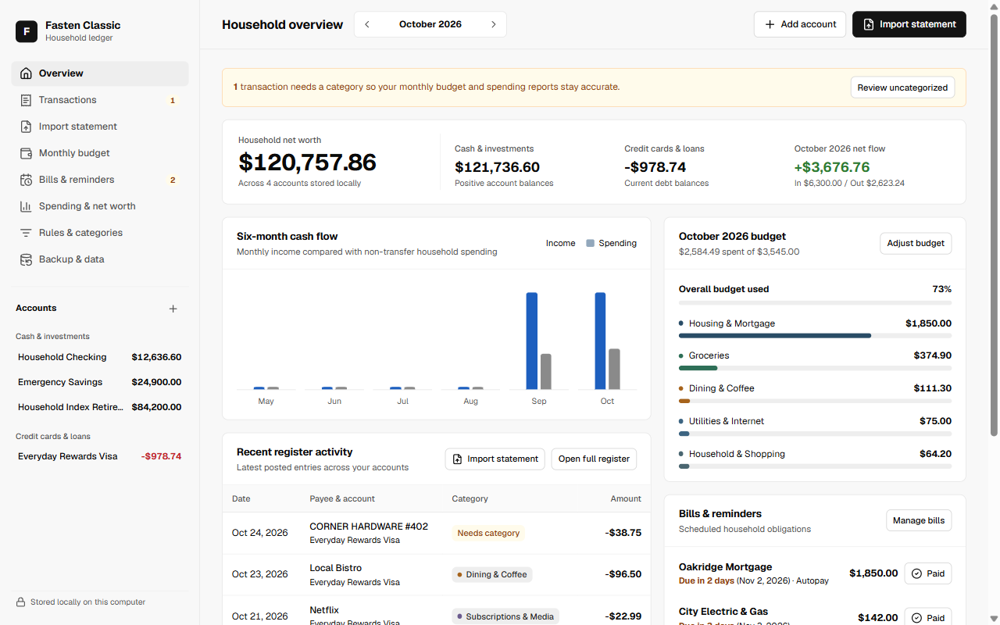
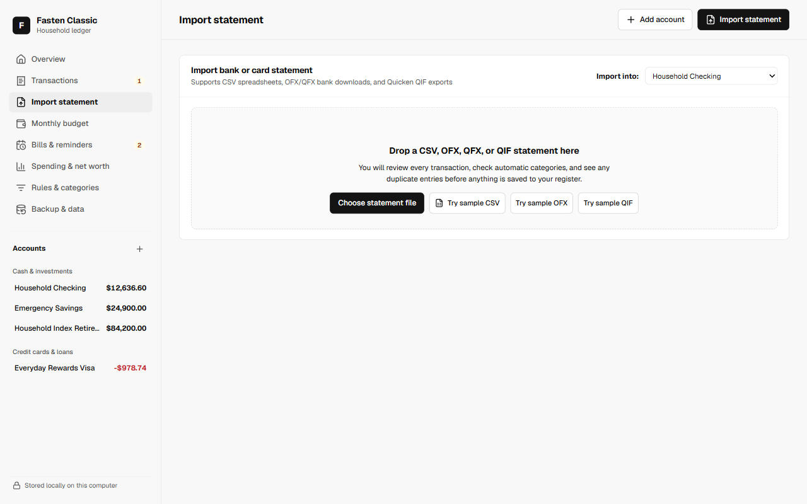
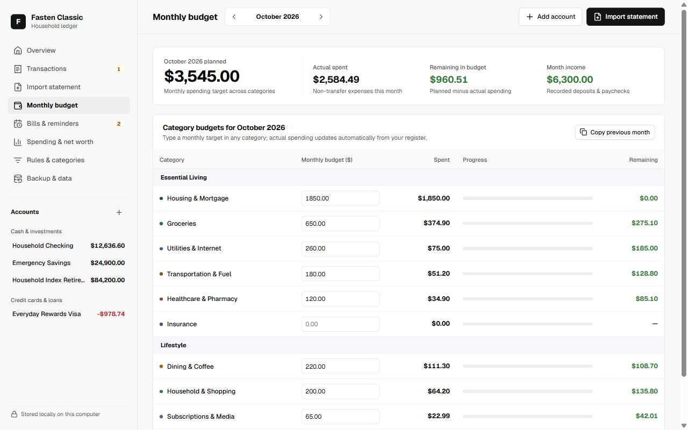

# Fasten Classic

> **Your household finances, on your computer. No subscription.**

Fasten Classic is a free, open-source consumer desktop application for household finances—built as a calm, locally stored alternative to Quicken Classic for Windows and macOS.



---

## Why Fasten Classic?

- **100% on your computer**: All accounts, transactions, budgets, and bills live in a local SQLite ledger on your own machine. No cloud login, no bank credentials stored online, and works completely offline.
- **No subscription**: Free and open-source under the MIT License.
- **Built for households, not accountants**: Plain-English checking, savings, credit card, loan, and retirement accounts—without double-entry accounting jargon.

## Features in v0.1

- **Statement imports with preview & duplicate detection**: Import bank and credit card statements in **CSV**, **OFX / QFX**, and **Quicken QIF** formats. Review every row, adjust CSV column mappings if needed, and automatically skip duplicate transactions when re-importing overlapping statements.
- **Automatic categorization rules**: Clean up cryptic bank payee names (such as `TRADER JOE'S #114` -> `Trader Joe's`) and assign categories automatically, with one-click rule creation right from the register.
- **Monthly category budgets**: Set monthly targets per category, copy last month's budget in one click, and compare planned vs. actual spending.
- **Recurring bills & reminders**: Track upcoming bills, autopay status, and due dates, and record bill payments directly into your account register.
- **Spending trends & net worth**: View six-month income vs. spending cash flow, category breakdowns, and an exact household net worth balance sheet (transfers between your own accounts are automatically excluded from spending totals).
- **Verified local backups**: Export and restore portable `.fastenbackup.json` files verified with a SHA-256 integrity checksum.

| Statement Import Preview | Monthly Category Budget |
| --- | --- |
|  |  |

---

## Installing & Getting Started (For Everyday Users)

### 1. Install Fasten Classic

- **Windows**: Download the latest `Fasten Classic_x.y.z_x64-setup.exe` from **Releases**, double-click it, and follow the two-step installer. Launch **Fasten Classic** from your Start Menu or Desktop.
- **macOS**: Download the latest `Fasten Classic_x.y.z_universal.dmg` from **Releases**, open it, and drag **Fasten Classic** into your **Applications** folder.

### 2. Your First Five Minutes

1. **Try sample data or add your first account**: On first launch, click **Explore with sample household data** to tour a complete household setup (you can clear it anytime under **Backup & data**), or click **Add your first account** to add your checking, savings, or credit card account.
2. **Download a statement from your bank**: Sign into your bank or card website and download recent activity as **OFX / QFX** (Web Connect), **CSV**, or **QIF**.
3. **Preview & save**: Click **Import statement**, drop your downloaded file in, review the automatically categorized entries, and click **Save transactions**.
4. **Set your monthly budget & bills**: Visit **Monthly budget** to enter spending targets for categories you care about, and **Bills & reminders** to add recurring monthly bills.
5. **Keep a backup copy**: Visit **Backup & data** anytime to save a backup file to an external drive or personal folder.

Sample statement files are also included in the [`samples/`](samples/) folder (`household-checking.csv`, `harbor-visa.ofx`, `quicken-export.qif`) if you want to test statement importing right away.

---

## Building from Source (For Developers)

### Prerequisites

- [Node.js](https://nodejs.org/) 20+
- [Rust](https://rustup.rs/) stable toolchain
- Platform WebView dependencies ([Tauri v2 prerequisites](https://v2.tauri.app/start/prerequisites/))

### Commands

```bash
# Install frontend dependencies
npm install

# Run in desktop development mode
npm run tauri:dev

# Run frontend & Rust ledger test suites
npm test
cd src-tauri && cargo test

# Build native desktop installer for your OS
npm run tauri:build
```

## License

Released under the [MIT License](LICENSE).
